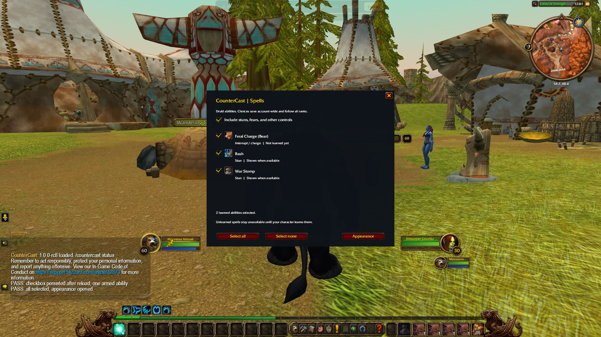

# CounterCast

Clickable interrupt and control abilities on enemy nameplates.

**WoW Forever · Interface 16001 · 1.0.0-rc8**

Release candidate / beta. Live-game acceptance is still required.


## Choose which spells appear

After updating, use `/reload`, then `/countercast spells`, or open the minimap menu and click **Choose spells**. Toggle individual class abilities or use **Select all** / **Select none**. Choices save account-wide across spell ranks. Unlearned spells remain unavailable until learned; pet and racial requirements still apply. Changes made in combat apply after combat ends. Appearance settings and defaults are preserved.

This release also includes rc7's saved-macro reuse repair: matching macros can be reused when character macro slots are full, without deleting existing macros or changing action-bar bindings.



See [behavior and simulator checks](docs/SPELL-SELECTION.md) and [147 passing Lua checks](docs/verification.json). The preview is from UIForever; it is not live-game casting proof.

## WowUp installation and publishing

Select WoW Forever in WowUp, choose **Install from URL**, and enter `https://github.com/paden1991/CounterCast` (without `.git`). Use the attached `-forever.zip` from [GitHub Releases](https://github.com/paden1991/CounterCast/releases), not the automatic Source code ZIP. Current versions remain prereleases; use the Beta channel if your manager asks.

Future `v<version>` tags trigger `.github/workflows/release.yml`. Update the TOC version and reviewed `source-manifest.json` hashes, run `python tools/build_release.py`, commit, then push the matching version tag. The workflow verifies all source hashes and TOC entries, packages one addon folder, and publishes the ZIP, Forever metadata and SHA-256 checksum. A tag/version mismatch or missing runtime file stops publication.

## Installation

Copy the `CounterCast` folder into your WoW Forever `Interface/AddOns` directory, then restart or reload the client. Alternatively, run `python tools/build_local.py` to create an installable ZIP under `dist/`.

Open the addon with `/countercast`.

## Verification

```sh
python -m pip install lupa
python tools/verify.py
python tools/build_local.py --verify-only
python tools/build_release.py
```

This checks the published runtime bytes against the reviewed source manifest. For repositories with external files, add `--local-addon` to verify the complete build. It is a source-integrity check, not live-game certification.

## Related addons

- [ProfPaden](https://github.com/paden1991/ProfPaden)
- [ProfPadenRoutes](https://github.com/paden1991/ProfPadenRoutes)
- [ProfPadenClams](https://github.com/paden1991/ProfPadenClams)
- [CounterCastProbe](https://github.com/paden1991/CounterCastProbe)
- [RAID](https://github.com/paden1991/RAID)

## Ownership and provenance

Public visibility does not assign a new open-source license. Existing third-party notices and applicable data licenses remain in force. Do not assume that excluded dependencies may be redistributed. No account SavedVariables, personal settings, raw research archives, credentials, or prior packaged releases are included.
